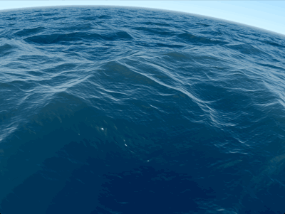
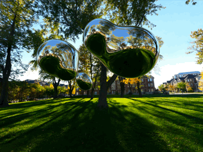
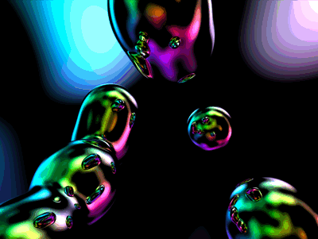
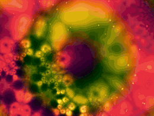
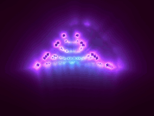
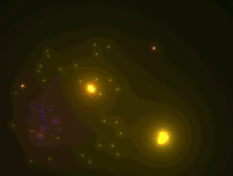

# shader_ios

Shadertoy shaders running outside the browser: a small desktop viewer that
runs shadertoy.com code as is, and an iOS app that runs the "Seascape"
shader natively with Metal.

<p align="center">
  
</p>

## Gallery

| | | |
| :---: | :---: | :---: |
| <br>`black_hole_shader.s` | <br>`chrome_shader.s` | <br>`reflect_shader.s` |
| <br>`cosmic_shader.s` | <br>`factal_shader.s` | <br>`fire_shader.s` |

All captured from the desktop viewer. The Seascape at the top is the same
shader the iOS app runs.

## Contents

| Path | What it is |
| --- | --- |
| `ios/SeaShader/` | SwiftUI + Metal iOS app that renders the Seascape shader full screen |
| `shadertoy.c`, `Makefile` | Standalone desktop Shadertoy viewer (OpenGL/GLUT) |
| `*_shader.s` | Shadertoy shaders (GLSL): sea, fire, chrome, reflect, cosmic, fractal, black hole |
| `cubemaps/park2/` | Default environment cube map used by the viewer |

## iOS app (SeaShader)

A full-screen port of [Seascape](https://www.shadertoy.com/view/Ms2SD1)
(`sea_shader.s`) to Metal Shading Language.

- `Sea.msl` — the shader, compiled at launch, so no offline Metal toolchain is needed
- `ShaderView.swift` — `MTKView` renderer at 60 fps, capped at 2x retina scale for speed
- Drag to look around: sideways turns the camera, up/down tilts it

### Running

1. Open `ios/SeaShader/SeaShader.xcodeproj` in Xcode.
2. Pick an iPhone or iPad (iOS 18+) or a simulator.
3. Set your team under *Signing & Capabilities* if you run on a device.
4. Build and run (⌘R).

## Desktop viewer

### Building

macOS (uses the system OpenGL and GLUT frameworks):

```sh
brew install gdk-pixbuf pkg-config
make
```

Linux needs `freeglut`, `glew` and `gdk-pixbuf` development packages, then `make`.

### Running shaders

```sh
./shadertoy sea_shader.s
```

Code copied straight from shadertoy.com works as is. Missing inputs
(`iTime`, `iResolution`, `iMouse`, ...) and a `main()` that calls
`mainImage()` are added automatically.

Images can be bound to `iChannel0`, `iChannel1`, ...:

```sh
./shadertoy --texture 0:texture0.png --texture 1:texture1.png <shader>
```

Add `o` after the channel number to show a texture once (no repeat) and `n`
for nearest-neighbor filtering:

```sh
./shadertoy --texture 0no:nyancat.png nyan.glsl
```

### Cube maps

Give either a directory with `px/nx/py/ny/pz/nz` (or `posx/negx/...`) images,
or the first of shadertoy-style files (`name.jpg`, `name_1.jpg` ... `name_5.jpg`):

```sh
./shadertoy --texture 0:cubemaps/park2 chrome_shader.s
```

Whether a channel is a cube map is detected from the shader. Cube map
channels with no texture get `cubemaps/park2` (next to the executable), or
a simple built-in sky if that folder is missing. 2D channels with no
texture get a built-in noise texture.

If the shader contains shadertoy's "Cube A" pass (a `mainCubemap()`
function, pasted into the same file with the "Common" code), it is rendered
once at startup and used for the cube map channels.

### Limitations

- No sound
- `iDate` and `iSampleRate` are not available

## Credits

- Standalone Shadertoy viewer by Simon Budig (2014), GPL v3 — see the header of `shadertoy.c`
- "Seascape" by Alexander Alekseev (TDM), CC BY-NC-SA 3.0
- `park2` cube map by Emil Persson (Humus) — see `cubemaps/park2/readme.txt`
- Other shaders are from shadertoy.com and keep their authors' licenses
